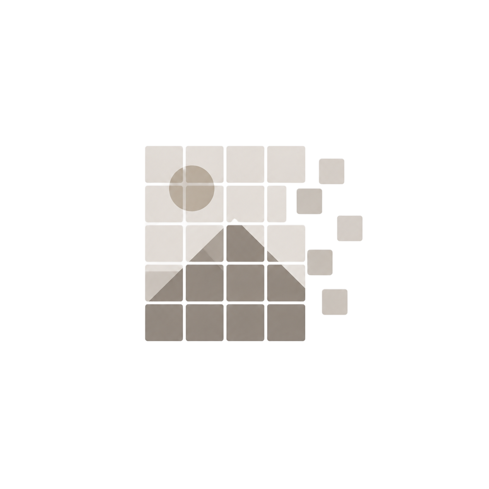

<div align="center">
  
  <p>
    <strong>Image Grid Processing for Rust</strong><br/>
    A high-performance library for extracting, analyzing, and manipulating row and column grids from images.
  </p>
  <p>
    <a href="https://github.com/elcoosp/grider/actions/workflows/ci.yml"></a>
    <a href="https://crates.io/crates/grider"></a>
    <a href="https://docs.rs/grider"></a>
    <a href="https://github.com/elcoosp/grider/blob/main/LICENSE"></a>
  </p>
</div>

---

## Installation

Add `grider` to your `Cargo.toml` dependencies:

```toml
[dependencies]
grider = "0.1"
```

Then, import it into your Rust project:

```rust
use grider::*;
```

## Usage

### Creating a Grid from an Image

Easily parse an image and extract its grid structure using the default configuration.

```rust
use grider::{Grid, GridConfig};
use image::open;

let img = open("path/to/image.png").expect("Failed to open image");
let config = GridConfig::default();
let grid = Grid::try_from_image_with_config(&img, config).expect("Failed to create grid");
```

### Accessing Rows and Columns

Iterate over the extracted grid elements to inspect their coordinates and properties.

```rust
for row in grid.rows() {
    println!("Row at y: {}", row.y);
}

for column in grid.columns() {
    println!("Column at x: {}", column.x);
}
```

### Custom Configuration

Fine-tune the grid extraction process by adjusting block size, merge thresholds, and parallel processing.

```rust
let config = GridConfig::new(
    15,    // Threshold block size
    0.9,   // Merge threshold ratio
    false, // Disable parallel processing
);
let grid = Grid::try_from_image_with_config(&img, config).expect("Failed to create grid");
```

> [!TIP]
> **Debugging with Visual Grid**  
> You can visually verify the extracted grid by overlaying it on the original image. This is invaluable for tuning your `GridConfig`.
> ```rust
> grider::debug::save_image_with_grid(
>     &img, 
>     &grid, 
>     "output_with_grid.png", 
>     &GridDrawingConfig::default()
> );
> ```

## API Reference

### Core Structs

| Struct | Description |
| :--- | :--- |
| **`Grid`** | Represents the extracted grid, containing lists of `Row` and `Column` elements. |
| **`Row`** | Represents a horizontal grid line. Contains `y` (coordinate), `height`, and `kind`. |
| **`Column`** | Represents a vertical grid line. Contains `x` (coordinate), `width`, and `kind`. |
| **`GridConfig`** | Configuration parameters for grid extraction (block size, merge ratio, parallelization). |
| **`GridDrawingConfig`** | Configuration parameters for rendering the debug overlay. |

### Enums

| Enum | Variants | Description |
| :--- | :--- | :--- |
| **`LineKind`** | `Empty`, `Full` | Represents the type of a line (row or column) based on its content density. |

### Key Functions

| Function | Description |
| :--- | :--- |
| `Grid::try_from_image_with_config` | Creates a grid from an image using a custom configuration. |
| `Grid::rows` / `Grid::columns` | Returns an iterator over all rows or columns in the grid. |
| `Grid::filtered_rows` / `Grid::filtered_columns` | Returns an iterator over rows/columns that match a given predicate. |
| `Grid::count_rows_by_kind` / `Grid::count_columns_by_kind` | Counts the number of rows or columns matching a specific `LineKind`. |
| `Grid::find_cells` | Finds grid cells based on specified row and column indices. |

### Macros

| Macro | Description |
| :--- | :--- |
| **`make_grid!`** | Conveniently constructs a `Grid` from a list of rows and columns. |
| **`make_line!`** | Quickly creates a `Row` or `Column` from a tuple of parameters. |

---

> [!NOTE]
> For detailed contribution guidelines, please refer to the [CONTRIBUTING.md](CONTRIBUTING.md) file.  
> This project is distributed under the terms of the MIT License. See [LICENSE](LICENSE) for details.
