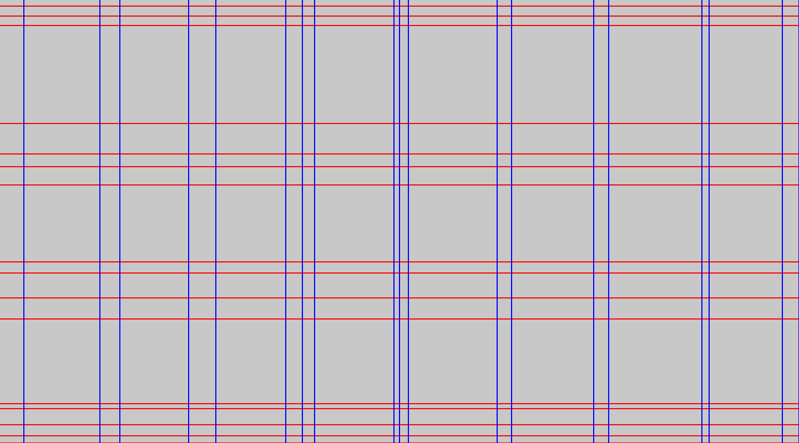

import { Aside, Code, LinkCard } from '@astrojs/starlight/components';

Ce guide montre comment visualiser une [`Grid`](/reference/grid/) sur une image, comment restyler chaque partie du dessin, et ce que le moteur de rendu peint exactement.

## Prérequis

- Grider installé avec les fonctionnalités par défaut (le dessin conditionne cette API)
- Une `Grid` extraite d'une image

## Sauvegarder la visualisation standard

Un appel rend la grille et écrit le fichier :

<Code lang="rust" code={`use grider::debug::save_image_with_grid;
use grider::drawing::GridDrawingConfig;
use grider::{Grid, GridConfig};
use image::open;

let img = open("tests/large.png").unwrap();
let grid = Grid::try_from_image_with_config(&img, GridConfig::default()).unwrap();

grider::debug::save_image_with_grid(
    &img,
    &grid,
    "output_with_grid.png",
    &GridDrawingConfig::default(),
)
.unwrap();`} />

Le binaire en ligne de commande exécute le même chemin par défaut : `grider tests/large.png` écrit `tests/large_with_grid.png` à côté de l'entrée.

## Savoir ce que le moteur de rendu peint

`Grid::draw` repeint l'image — il n'annote pas les pixels originaux :

1. Chaque rectangle de cellule est rempli avec `cell_background_color` (gris clair par défaut, `Rgba([200, 200, 200, 255])`), éventuellement en retrait par `padding`.
2. Une bande horizontale de `line_thickness` pixels centrée sur le `end()` de chaque ligne (son bord inférieur) est dessinée dans `row_color` (rouge par défaut).
3. Une bande verticale de la même épaisseur centrée sur le `end()` de chaque colonne (son bord droit) est dessinée dans `column_color` (bleu par défaut).

Le résultat visualise la géométrie de la grille ; le contenu de l'image originale reste caché en dessous. C'est l'outil pour vérifier une extraction, et les valeurs par défaut sont ce que vous voyez dans la figure ci-dessous.

## Restyler avec le builder

`GridDrawingConfig::builder()` remplace un réglage à la fois :

<Code lang="rust" code={`use grider::drawing::GridDrawingConfig;
use image::Rgba;

let config = GridDrawingConfig::builder()
    .padding(2)
    .row_color(Rgba([255, 0, 0, 255]))
    .column_color(Rgba([0, 0, 255, 255]))
    .cell_background_color(Rgba([200, 200, 200, 255]))
    .line_thickness(3)
    .build();`} />

| Champ | Défaut | Signification |
| :--- | :--- | :--- |
| `padding` | `0` | Retrait appliqué à chaque rectangle de cellule, en pixels |
| `row_color` | `Rgba([255, 0, 0, 255])` | Couleur de la bande horizontale |
| `column_color` | `Rgba([0, 0, 255, 255])` | Couleur de la bande verticale |
| `cell_background_color` | `Rgba([200, 200, 200, 255])` | Remplissage de la cellule |
| `line_thickness` | `2` | Épaisseur de la bande en pixels (minimum `1`) |

## Colorer les lignes par index

Les fournisseurs de couleurs remplacent les couleurs uniformes et reçoivent l'index de la ligne. Numéroter les lignes ou mettre en évidence les alternances prend une seule fermeture :

<Code lang="rust" code={`use grider::drawing::GridDrawingConfig;
use image::Rgba;

let config = GridDrawingConfig::builder()
    .row_color_provider(Box::new(|index| {
                    if index % 2 == 0 {
                                    Rgba([220, 20, 20, 255])
                    } else {
                                    Rgba([255, 140, 0, 255])
                    }
    }))
    .build();`} />

Lorsqu'un fournisseur est défini, `row_color_at(index)` et `column_color_at(index)` retournent son résultat pour cet index ; sinon ils retombent sur `row_color` / `column_color`.

## Dessiner des pièces individuelles

`Cell`, `Row`, `Column` et `Grid` implémentent le trait `Drawable`. Le dessin est infaillible par construction — chaque bande et rectangle est découpé aux limites de l'image :

<Code lang="rust" code={`use grider::drawing::{Drawable, GridDrawingConfig};
use grider::{LineInfo, LineKind, Row};
use image::RgbaImage;

let mut image = RgbaImage::new(100, 100);
let config = GridDrawingConfig::default();
let row = Row::new(LineInfo::new(0, 10, LineKind::Full));
row.draw(&mut image, &config);`} />

## Étapes suivantes

<LinkCard title="Référence de l'API de dessin" description="La documentation complète de GridDrawingConfig, du builder et de Drawable." href="/reference/drawing/" />
<LinkCard title="Configurer l'extraction" description="Améliorez la grille elle-même avant de la styliser." href="/guides/configure-extraction/" />
