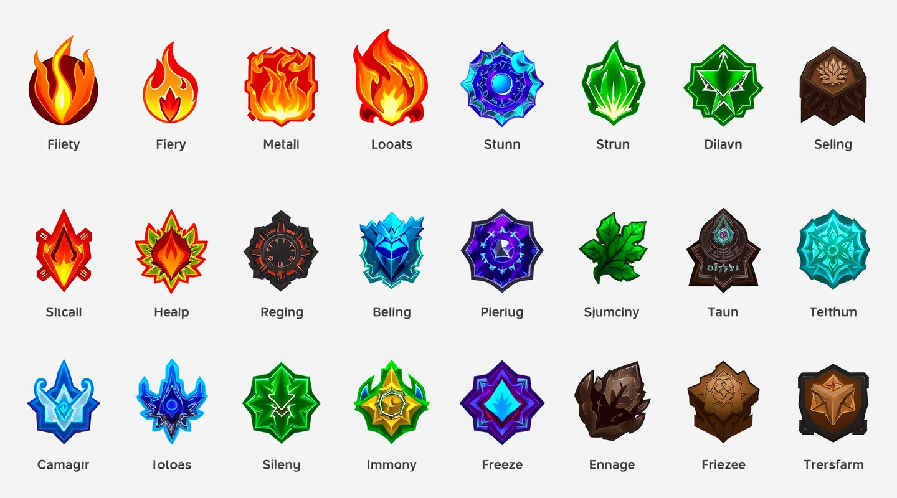
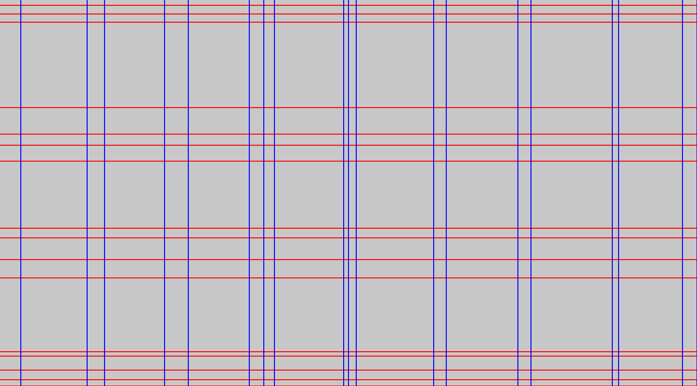

import { Aside, Code, LinkCard, Steps, TabItem, Tabs } from '@astrojs/starlight/components';

Ce tutoriel vous guide à travers le parcours doré de Grider : vous chargez une image, extrayez sa grille, inspectez chaque ligne et colonne, visitez les cellules, et sauvegardez une visualisation. Vous terminez avec un projet Rust fonctionnel et un fichier `*_with_grid.png` rendu sur le disque.

## Prérequis

- Rust 1.89 ou plus récent (`rustc --version` pour vérifier). Vous pouvez installer Rust avec [rustup](https://rustup.rs).
- Un terminal.

## Ce que vous construisez

Vous écrivez un petit programme qui transforme cette capture d'écran de tableau en une grille structurée de 16 lignes et 19 colonnes, où chaque bande est étiquetée `Empty` (arrière-plan) ou `Full` (contenu) :

| Image d'entrée | Sortie réelle de `save_image_with_grid` |
| :--- | :--- |
|  |  |

## 1. Créer un projet

<Code lang="bash" code={`cargo new hello-grider
cd hello-grider`} />

## 2. Ajouter la dépendance

<Code lang="bash" code={`cargo add grider`} />

Cela ajoute la dernière version publiée — `0.3` — à votre `Cargo.toml`. Grider prend en charge Rust 1.89 et plus récent et est livré avec les fonctionnalités `serde` et `drawing` activées.

<Aside kind="note">
    Vous pouvez aussi utiliser le binaire en ligne de commande pour une inspection rapide. Passez à
    [l'étape 7]() après l'avoir installé avec
    `cargo install grider`.
</Aside>

## 3. Charger une image

Remplacez le contenu de `src/main.rs` par du code qui ouvre un fichier image avec le crate `image`. Grider accepte n'importe quelle `DynamicImage` et convertit les images non-grises pour vous :

<Code lang="rust" code={`use grider::{Grid, GridConfig};
use image::open;

fn main() {
    let img = open("tests/large.png").expect("Failed to open image");
    let grid = Grid::try_from_image_with_config(&img, GridConfig::default())
                    .expect("Failed to create grid");
    println!("{grid}");
}`} />

## 4. Extraire la grille

Un appel fait tout le pipeline — binarisation, le scan de vacuité fusionné, l'encodage par plages et la fusion de lignes :

<Code lang="rust" code={`let grid = Grid::try_from_image_with_config(&img, GridConfig::default())
    .expect("Failed to create grid");`} />

La fonction retourne un `Result`. L'extraction depuis une image de taille nulle ou avec une configuration invalide retourne une [`GridError`](/reference/errors/).

## 5. Inspecter les lignes, colonnes et cellules

Étendez `main` pour parcourir le résultat. Chaque `Row` a `y`, `height` et `kind` ; chaque `Column` a `x`, `width` et `kind` ; chaque `Cell` est l'intersection d'une ligne et d'une colonne :

<Code lang="rust" code={`for row in grid.rows() {
    println!("Row at y: {} ({:?})", row.y, row.kind);
}

for column in grid.columns() {
    println!("Column at x: {}", column.x);
}

// Every intersection of the grid:
for cell in grid.iter_cells() {
    let rect = cell.rect();
    println!("cell {}x{} ({}x{})", rect.left(), rect.top(), rect.width(), rect.height());
}`} />

<Aside kind="tip">
    `Grid` implémente `Display`, donc `println!("{grid}")` imprime un résumé compact tel que
    `Grid { rows: 16, columns: 19 }`.
</Aside>

## 6. Vérifier le résultat sur une petite image

Le dépôt contient un test de snapshot que vous pouvez reproduire sans fichier de fixture. Il construit une image blanche 3 × 3 avec un seul pixel noir au centre et extrait la grille avec `threshold_block_size: 3` et `merge_threshold_ratio: 0.5` :

<Code lang="rust" code={`use grider::{Binarization, Grid, GridConfig};
use image::DynamicImage;

let img = image::GrayImage::from_raw(3, 3, vec![255, 255, 255, 255, 0, 255, 255, 255, 255])
    .unwrap();
let dynamic_img = DynamicImage::ImageLuma8(img);
let config = GridConfig {
    threshold_block_size: 3,
    merge_threshold_ratio: 0.5,
    threshold_delta: 0,
    enable_parallel: false,
    binarization: Binarization::AdaptiveMean,
};
let grid = Grid::try_from_image_with_config(&dynamic_img, config).unwrap();`} />

Le snapshot de test commité enregistre exactement ce que cela produit — la ligne centrale et la colonne centrale sont `Full`, tout le reste est `Empty` :

<Code lang="yaml" code={`rows:
    - y: 0
  height: 1
  kind: Empty
    - y: 1
  height: 1
  kind: Full
    - y: 2
  height: 1
  kind: Empty
columns:
    - x: 0
  width: 1
  kind: Empty
    - x: 1
  width: 1
  kind: Full
    - x: 2
  width: 1
  kind: Empty`} />

## 7. Exécuter la CLI sur la même image

Le crate livre un binaire avec les mêmes pouvoirs que la bibliothèque. Installez-le, puis pointez-le vers votre image :

<Code lang="bash" code={`cargo install grider
grider tests/large.png`} />

La commande imprime un résumé, puis sauvegarde la superposition à côté du fichier d'entrée sous `<image>_with_grid.png` :

<Code lang="ansi" code={`Extracted grid in 7.22ms
Grid { rows: 16, columns: 19 }
Full rows: 7, empty rows: 9, full columns: 9, empty columns: 10
Saving overlay to tests/large_with_grid.png`} />

Ajoutez `--json` pour imprimer toute la grille en JSON au lieu d'écrire une superposition, et `--quiet` pour supprimer le résumé :

<Code lang="bash" code={`grider tests/large.png --json --quiet`} />

## Dépannage

- **`Failed to open image`** — le chemin est faux ou le format n'est pas pris en charge par le crate `image`. Passez le même chemin dans `image::open` pour confirmer.
- **Tout est une bande `Full` géante** — votre arrière-plan est plus sombre que le contenu. Baissez [`threshold_delta`](/reference/grid-config/) (les valeurs négatives rendent le seuil plus strict), ou passez à la [binarisation Sauvola](/guides/choose-binarization/) pour un éclairage inégal.
- **Les lignes de contenu fines manquent** — les petites plages fusionnent dans leurs voisines lorsqu'elles sont plus courtes que `merge_threshold_ratio × moyenne`. Baissez le ratio, par exemple `.merge_threshold_ratio(0.5)`.

## Étapes suivantes

<LinkCard title="Configurer l'extraction" description="Réglez chaque paramètre du pipeline de détection avec GridConfig." href="/guides/configure-extraction/" />
<LinkCard title="Dessiner des grilles et des cellules" description="Changez les couleurs, l'épaisseur et la marge de la visualisation." href="/guides/draw-overlays/" />
