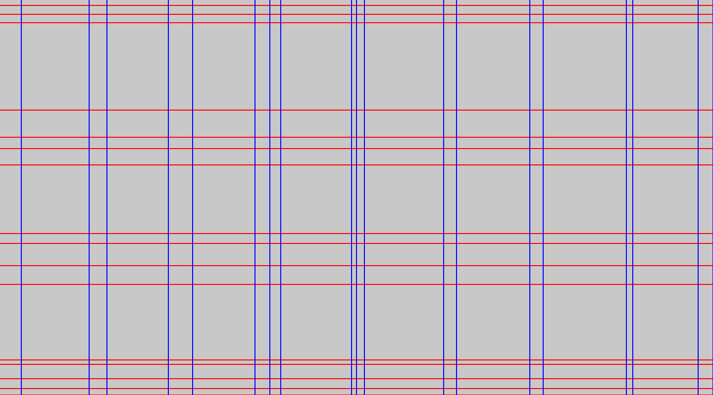

import { Aside, LinkCard } from '@astrojs/starlight/components';

This guide shows you how to visualize a [`Grid`](/reference/grid/) on an image, how to restyle every part of the drawing, and what exactly the renderer paints.

## Prerequisites

- Grider installed with the default features (drawing gates this API)
- A `Grid` extracted from an image

## Save the standard visualization

One call renders the grid and writes the file:

```rust
use grider::debug::save_image_with_grid;
use grider::drawing::GridDrawingConfig;
use grider::{Grid, GridConfig};
use image::open;

let img = open("tests/large.png").unwrap();
let grid = Grid::try_from_image_with_config(&img, GridConfig::default()).unwrap();

grider::debug::save_image_with_grid(
    &img,
    &grid,
    "output_with_grid.png",
    &GridDrawingConfig::default(),
)
.unwrap();
```

The command-line binary runs the same path by default: `grider tests/large.png` writes `tests/large_with_grid.png` next to the input.

## Know what the renderer paints

`Grid::draw` repaints the picture — it does not annotate the original pixels:

1. Every cell rectangle is filled with `cell_background_color` (default light gray, `Rgba([200, 200, 200, 255])`), optionally inset by `padding`.
2. A horizontal band of `line_thickness` pixels centered on each row's `end()` (its bottom edge) is drawn in `row_color` (default red).
3. A vertical band of the same thickness centered on each column's `end()` (its right edge) is drawn in `column_color` (default blue).

The result visualizes the grid geometry; the original image content stays hidden underneath. This is the tool for verifying an extraction, and the defaults are what you see in the figure below.



## Restyle with the builder

`GridDrawingConfig::builder()` overrides one setting at a time:

```rust
use grider::drawing::GridDrawingConfig;
use image::Rgba;

let config = GridDrawingConfig::builder()
    .padding(2)
    .row_color(Rgba([255, 0, 0, 255]))
    .column_color(Rgba([0, 0, 255, 255]))
    .cell_background_color(Rgba([200, 200, 200, 255]))
    .line_thickness(3)
    .build();
```

| Field | Default | Meaning |
| :--- | :--- | :--- |
| `padding` | `0` | Inset applied to every cell rectangle, in pixels |
| `row_color` | `Rgba([255, 0, 0, 255])` | Horizontal band color |
| `column_color` | `Rgba([0, 0, 255, 255])` | Vertical band color |
| `cell_background_color` | `Rgba([200, 200, 200, 255])` | Cell fill |
| `line_thickness` | `2` | Band thickness in pixels (minimum `1`) |

## Color lines by index

Color providers replace the uniform colors and receive the line index. Numbering rows or highlighting alternates takes one closure:

```rust
use grider::drawing::GridDrawingConfig;
use image::Rgba;

let config = GridDrawingConfig::builder()
    .row_color_provider(Box::new(|index| {
        if index % 2 == 0 {
            Rgba([220, 20, 20, 255])
        } else {
            Rgba([255, 140, 0, 255])
        }
    }))
    .build();
```

When a provider is set, `row_color_at(index)` and `column_color_at(index)` return its result for that index; otherwise they fall back to `row_color` / `column_color`.

## Draw individual pieces

`Cell`, `Row`, `Column` and `Grid` implement the `Drawable` trait. Drawing is infallible by construction — every band and rectangle is clipped to the image bounds:

```rust
use grider::drawing::{Drawable, GridDrawingConfig};
use grider::{LineInfo, LineKind, Row};
use image::RgbaImage;

let mut image = RgbaImage::new(100, 100);
let config = GridDrawingConfig::default();
let row = Row::new(LineInfo::new(0, 10, LineKind::Full));
row.draw(&mut image, &config);
```

## Next steps

<LinkCard title="Drawing API reference" description="The full GridDrawingConfig, builder and Drawable documentation." href="/reference/drawing/" />
<LinkCard title="Configure extraction" description="Improve the grid itself before styling it." href="/guides/configure-extraction/" />
