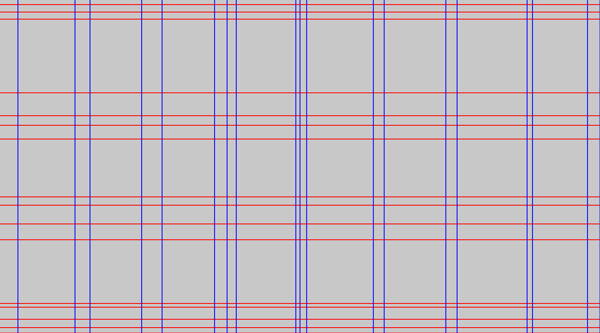

import { Aside, Code, LinkCard } from '@astrojs/starlight/components';

This guide shows you how to visualize a [`Grid`](/reference/grid/) on an image, how to restyle every part of the drawing, and what exactly the renderer paints.

## Prerequisites

- Grider installed with the default features (drawing gates this API)
- A `Grid` extracted from an image

## Save the standard visualization

One call renders the grid and writes the file:

<Code lang="rust" code={"use grider::debug::save_image_with_grid;\nuse grider::drawing::GridDrawingConfig;\nuse grider::{Grid, GridConfig};\nuse image::open;\n\nlet img = open(\"tests/large.png\").unwrap();\nlet grid = Grid::try_from_image_with_config(&img, GridConfig::default()).unwrap();\n\ngrider::debug::save_image_with_grid(\n    &img,\n    &grid,\n    \"output_with_grid.png\",\n    &GridDrawingConfig::default(),\n)\n.unwrap();"} />

The command-line binary runs the same path by default: `grider tests/large.png` writes `tests/large_with_grid.png` next to the input.

## Know what the renderer paints

`Grid::draw` repaints the picture — it does not annotate the original pixels:

1. Every cell rectangle is filled with `cell_background_color` (default light gray, `Rgba([200, 200, 200, 255])`), optionally inset by `padding`.
2. A horizontal band of `line_thickness` pixels centered on each row's `end()` (its bottom edge) is drawn in `row_color` (default red).
3. A vertical band of the same thickness centered on each column's `end()` (its right edge) is drawn in `column_color` (default blue).

The result visualizes the grid geometry; the original image content stays hidden underneath. This is the tool for verifying an extraction, and the defaults are what you see in the figure below.

## Restyle with the builder

`GridDrawingConfig::builder()` overrides one setting at a time:

<Code lang="rust" code={"use grider::drawing::GridDrawingConfig;\nuse image::Rgba;\n\nlet config = GridDrawingConfig::builder()\n    .padding(2)\n    .row_color(Rgba([255, 0, 0, 255]))\n    .column_color(Rgba([0, 0, 255, 255]))\n    .cell_background_color(Rgba([200, 200, 200, 255]))\n    .line_thickness(3)\n    .build();"} />

| Field | Default | Meaning |
| :--- | :--- | :--- |
| `padding` | `0` | Inset applied to every cell rectangle, in pixels |
| `row_color` | `Rgba([255, 0, 0, 255])` | Horizontal band color |
| `column_color` | `Rgba([0, 0, 255, 255])` | Vertical band color |
| `cell_background_color` | `Rgba([200, 200, 200, 255])` | Cell fill |
| `line_thickness` | `2` | Band thickness in pixels (minimum `1`) |

## Color lines by index

Color providers replace the uniform colors and receive the line index. Numbering rows or highlighting alternates takes one closure:

<Code lang="rust" code={"use grider::drawing::GridDrawingConfig;\nuse image::Rgba;\n\nlet config = GridDrawingConfig::builder()\n    .row_color_provider(Box::new(|index| {\n                    if index % 2 == 0 {\n                                    Rgba([220, 20, 20, 255])\n                    } else {\n                                    Rgba([255, 140, 0, 255])\n                    }\n    }))\n    .build();"} />

When a provider is set, `row_color_at(index)` and `column_color_at(index)` return its result for that index; otherwise they fall back to `row_color` / `column_color`.

## Draw individual pieces

`Cell`, `Row`, `Column` and `Grid` implement the `Drawable` trait. Drawing is infallible by construction — every band and rectangle is clipped to the image bounds:

<Code lang="rust" code={"use grider::drawing::{Drawable, GridDrawingConfig};\nuse grider::{LineInfo, LineKind, Row};\nuse image::RgbaImage;\n\nlet mut image = RgbaImage::new(100, 100);\nlet config = GridDrawingConfig::default();\nlet row = Row::new(LineInfo::new(0, 10, LineKind::Full));\nrow.draw(&mut image, &config);"} />

## Next steps

<LinkCard title="Drawing API reference" description="The full GridDrawingConfig, builder and Drawable documentation." href="/reference/drawing/" />
<LinkCard title="Configure extraction" description="Improve the grid itself before styling it." href="/guides/configure-extraction/" />
