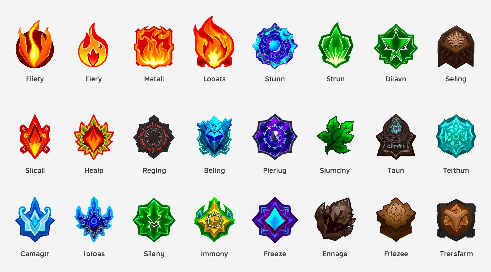
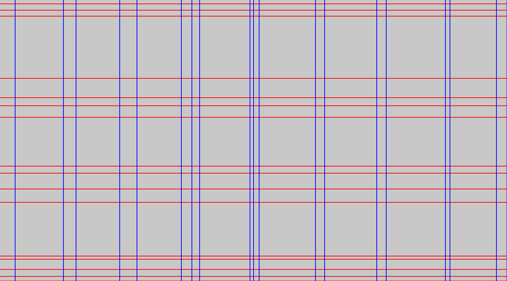

import { Aside, Code, LinkCard, Steps, TabItem, Tabs } from '@astrojs/starlight/components';

This tutorial walks you through the golden path of Grider: you load an image, extract its grid, inspect every row and column, visit the cells, and save a visualization. You finish with a working Rust project and a rendered `*_with_grid.png` on disk.

## Prerequisites

- Rust 1.89 or newer (`rustc --version` to check). You can install Rust with [rustup](https://rustup.rs).
- A terminal.

## What you build

You write a small program that turns this table screenshot into a structured grid of 16 rows and 19 columns, where each band is tagged `Empty` (background) or `Full` (content):

| Input image | Real `save_image_with_grid` output |
| :--- | :--- |
|  |  |

## 1. Create a project

<Code lang="bash" code={`cargo new hello-grider
cd hello-grider`} />

## 2. Add the dependency

<Code lang="bash" code={`cargo add grider`} />

This adds the latest published release — `0.3` — to your `Cargo.toml`. Grider supports Rust 1.89 and newer and ships with the `serde` and `drawing` features enabled.

<Aside kind="note">
    You can also use the command-line binary for quick inspection. Skip to
    [step 7](#7-run-the-cli-on-the-same-image) after installing it with
    `cargo install grider`.
</Aside>

## 3. Load an image

Replace the contents of `src/main.rs` with code that opens an image file with the `image` crate. Grider accepts any `DynamicImage` and converts non-grayscale images for you:

<Code lang="rust" code={`use grider::{Grid, GridConfig};
use image::open;

fn main() {
    let img = open("tests/large.png").expect("Failed to open image");
    let grid = Grid::try_from_image_with_config(&img, GridConfig::default())
                    .expect("Failed to create grid");
    println!("{grid}");
}`} />

## 4. Extract the grid

One call does the whole pipeline — binarization, the fused emptiness scan, run-length encoding, and line merging:

<Code lang="rust" code={`let grid = Grid::try_from_image_with_config(&img, GridConfig::default())
    .expect("Failed to create grid");`} />

The function returns a `Result`. Extracting from a zero-sized image or with an invalid configuration returns a [`GridError`](/reference/errors/).

## 5. Inspect rows, columns and cells

Extend `main` to walk the result. Every `Row` has `y`, `height` and `kind`; every `Column` has `x`, `width` and `kind`; every `Cell` is the intersection of one row and one column:

<Code lang="rust" code={`for row in grid.rows() {
    println!("Row at y: {} ({:?})", row.y, row.kind);
}

for column in grid.columns() {
    println!("Column at x: {}", column.x);
}

// Every intersection of the grid:
for cell in grid.iter_cells() {
    let rect = cell.rect();
    println!("cell {}x{} ({}x{})", rect.left(), rect.top(), rect.width(), rect.height());
}`} />

<Aside kind="tip">
    `Grid` implements `Display`, so `println!("{grid}")` prints a compact summary such as
    `Grid { rows: 16, columns: 19 }`.
</Aside>

## 6. Verify the result on a tiny image

The repository contains a snapshot test you can reproduce without any fixture file. It builds a 3 × 3 white image with a single black pixel in the center and extracts the grid with `threshold_block_size: 3` and `merge_threshold_ratio: 0.5`:

<Code lang="rust" code={`use grider::{Binarization, Grid, GridConfig};
use image::DynamicImage;

let img = image::GrayImage::from_raw(3, 3, vec![255, 255, 255, 255, 0, 255, 255, 255, 255])
    .unwrap();
let dynamic_img = DynamicImage::ImageLuma8(img);
let config = GridConfig {
    threshold_block_size: 3,
    merge_threshold_ratio: 0.5,
    threshold_delta: 0,
    enable_parallel: false,
    binarization: Binarization::AdaptiveMean,
};
let grid = Grid::try_from_image_with_config(&dynamic_img, config).unwrap();`} />

The committed test snapshot records exactly what this produces — the center row and center column are `Full`, everything else is `Empty`:

<Code lang="yaml" code={`rows:
    - y: 0
  height: 1
  kind: Empty
    - y: 1
  height: 1
  kind: Full
    - y: 2
  height: 1
  kind: Empty
columns:
    - x: 0
  width: 1
  kind: Empty
    - x: 1
  width: 1
  kind: Full
    - x: 2
  width: 1
  kind: Empty`} />

## 7. Run the CLI on the same image

The crate ships a binary with the same powers as the library. Install it, then point it at your image:

<Code lang="bash" code={`cargo install grider
grider tests/large.png`} />

The command prints a summary, then saves the overlay next to the input file as `<image>_with_grid.png`:

<Code lang="ansi" code={`Extracted grid in 7.22ms
Grid { rows: 16, columns: 19 }
Full rows: 7, empty rows: 9, full columns: 9, empty columns: 10
Saving overlay to tests/large_with_grid.png`} />

Add `--json` to print the whole grid as JSON instead of writing an overlay, and `--quiet` to suppress the summary:

<Code lang="bash" code={`grider tests/large.png --json --quiet`} />

## Troubleshooting

- **`Failed to open image`** — the path is wrong or the format is unsupported by the `image` crate. Run the same path through `image::open` to confirm.
- **Everything is one giant `Full` band** — your background is darker than the content. Lower [`threshold_delta`](/reference/grid-config/) (negative values make the threshold stricter), or switch to [Sauvola binarization](/guides/choose-binarization/) for uneven lighting.
- **Thin content lines are missing** — small runs merge into their neighbours when they are shorter than `merge_threshold_ratio × average`. Lower the ratio, for example `.merge_threshold_ratio(0.5)`.

## Next steps

<LinkCard title="Configure extraction" description="Tune every knob of the detection pipeline with GridConfig." href="/guides/configure-extraction/" />
<LinkCard title="Draw grids and cells" description="Change colors, thickness and padding of the visualization." href="/guides/draw-overlays/" />
